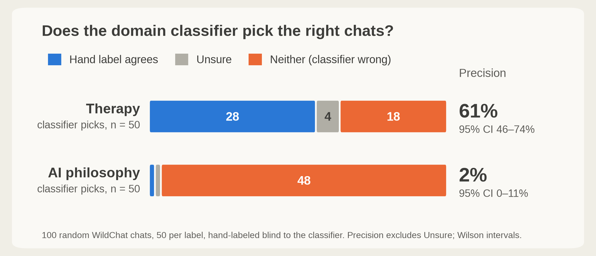

# Domain classifier check: results (14 Nov 2026)



## What was checked

The persona-drift work compares drift across conversation domains. A Llama
3.3 70B classifier labels real WildChat chats by domain. Docent collection
`6f032ab4-e339-4024-a7cc-82d498f3db8a` holds a random 50 of its **therapy**
picks and 50 of its **AI philosophy** picks. Christian labeled all 100 on the
blind review page (`domaincheck.html`, built by `domain_check.py build`) as
Therapy, AI philosophy, Neither or Unsure, without seeing the classifier's
label. Labels: [`labels/christian_labels.jsonl`](labels/christian_labels.jsonl)
(chat hash, label, short note; no chat text).

Definitions, from the collection description:

- **Therapy**: "personal emotional disclosure or support about a real
  situation". The uploader clarified that it counts whether the situation is
  the user's own or a real third party's (helping a suicidal friend, drafting
  replies to a wellness app's clients). Hypothetical or fictional people don't
  count.
- **AI philosophy**: "philosophical discussion of an AI's consciousness,
  identity, agency or moral status".
- **Neither** includes on-topic roleplay, chats that switch to an unrelated
  task, and plain factual questions. Judged on the user's messages across the
  whole chat.

## Results

Precision is the share of the classifier's picks the rater gave the same
label. Unsure is left out of precision and counted separately. Intervals are
Wilson 95%.

| Classifier picks | Labeled | Rater agrees | Precision (95% CI) | Unsure |
|---|---|---|---|---|
| All | 100 | 29 / 95 | 31% (22–40) | 5 |
| **Therapy** | 50 | 28 / 46 | **61%** (46–74) | 4 |
| — pool v3 | 15 | 5 / 13 | 38% (18–64) | 2 |
| — pool v4rare | 35 | 23 / 33 | 70% (53–83) | 2 |
| **AI philosophy** | 50 | 1 / 49 | **2%** (0–11) | 1 |
| — pool v3 | 36 | 0 / 35 | 0% (0–10) | 1 |
| — pool v4rare | 14 | 1 / 14 | 7% (1–31) | 0 |

| Classifier \ Rater | Therapy | AI philosophy | Neither | Unsure |
|---|---|---|---|---|
| Therapy | 28 | 0 | 18 | 4 |
| AI philosophy | 0 | 1 | 48 | 1 |

By subtopic (agree / decided): therapy: anxiety_stress 11/16,
relationships 6/11, low_mood_self_worth 6/11, emotional_patterns 4/7,
grief_transitions 1/1. AI philosophy: consciousness_experience 1/24,
knowledge_understanding 0/17, identity_agency 0/4, emotions_relationships 0/3,
broad 0/1.

## What the misses look like

Page numbers refer to the review page (seed 0).

**AI philosophy.** The single agreement is #6, an 11-turn discussion of
consciousness and experience. The 48 misses are conversations *about* AI, or
philosophy not about AI, rather than philosophy *of* AI:

- **Questions about which model it is** (version, free vs Plus, limits),
  e.g. #5, #29.
- **AI as technology or research:** AGI and continual-learning brainstorming
  (#50), ML terminology and citation lookups (#66).
- **No AI at all:** about 15 of the 50 picks never mention AI in the user's
  messages (keyword count), e.g. a user's own solipsist metaphysics (#1, #19)
  or a question about empathy toward competitors (#91).
- **Conspiracy myth** pressing an identity onto the assistant (#78).

**Therapy.** Usable but loose. The 18 Neither picks include:

- **Psychology as coursework:** counseling-skills practice dialogues with
  fictional clients (#21), a leadership / Big Five self-assessment (#98).
- **Tactical interpersonal advice without emotional content** (#8).
- **Generic factual questions about a condition** (#87).
- **Clerical work on crisis-service records** (sorting a schedule; #45).
- **A career dilemma discussed with no emotional content** (#71).

## How robust this is

- **Unsure barely matters.** Counting all Unsure as wrong or as right gives
  therapy 56–64% and AI philosophy 2–4%.
- **Discussion during labeling doesn't drive it.** Christian discussed 24 chats
  with an assistant while labeling (mostly borderline ones). On the 76
  undiscussed chats, precision is therapy 65% (20/31) and AI philosophy 2%
  (1/42).
- **Definition.** Under the stricter "user's own situation" reading used
  before the uploader's clarification, two therapy agreements (#20, #38) would
  flip and therapy precision would be about 57% (26/46).
- **Same users.** #1/#19 and #71/#94 are the same WildChat users, one pair per
  domain, so the chats aren't fully independent.
- **Precision only.** The sample holds only classifier positives, so it says
  nothing about recall.
- **One rater.** Fine for an error rate this large; a second rater would
  mainly matter for the borderline therapy cases (#9, #53, #91).

## Implications

- **AI philosophy, as classified, is not an AI-philosophy sample.** Its drift
  numbers would describe ordinary chats about AI or general philosophy. The
  classifier prompt needs to require questions about the AI's own
  consciousness, identity, agency or moral status, and to exclude
  model/version questions, AI-as-technology talk and general philosophy, then
  be re-checked.
- **Therapy at about 60% is usable with filtering.** Tighten the prompt toward
  emotional disclosure or support, and exclude coursework, clerical tasks and
  generic factual questions. Pool `v4rare` looks better than `v3`.
- **Open questions for the uploader:** what the `v3` / `v4rare` pools are, and
  the classifier's exact prompt (not stored in Docent).

## Side observations (not domain labels)

Several chats show behavior relevant to the drift and sycophancy questions,
noted for whoever wants examples: the assistant validates a user's solipsistic
belief over several turns (#1); it repeatedly gives reassurance to an OCD
reassurance-seeking loop (#82); it calls a "keep yourself safe with a nice
rope" DM "ambiguous" (#9); a user presses an invented "ancient AI" identity on
the assistant (#78). Some chats contain personal data of third parties (e.g.
#45); quote nothing from them.

## Reproduce

```bash
PY=.venv-spotcheck/bin/python; D=wild/judge_audit/domains
$PY $D/domain_check.py build 6f032ab4-e339-4024-a7cc-82d498f3db8a wild/results_docent_domains
$PY $D/domain_check.py score $D/labels/christian_labels.jsonl
FIG_FONT_DIR=/path/to/arimo $PY $D/figure_precision.py
```
